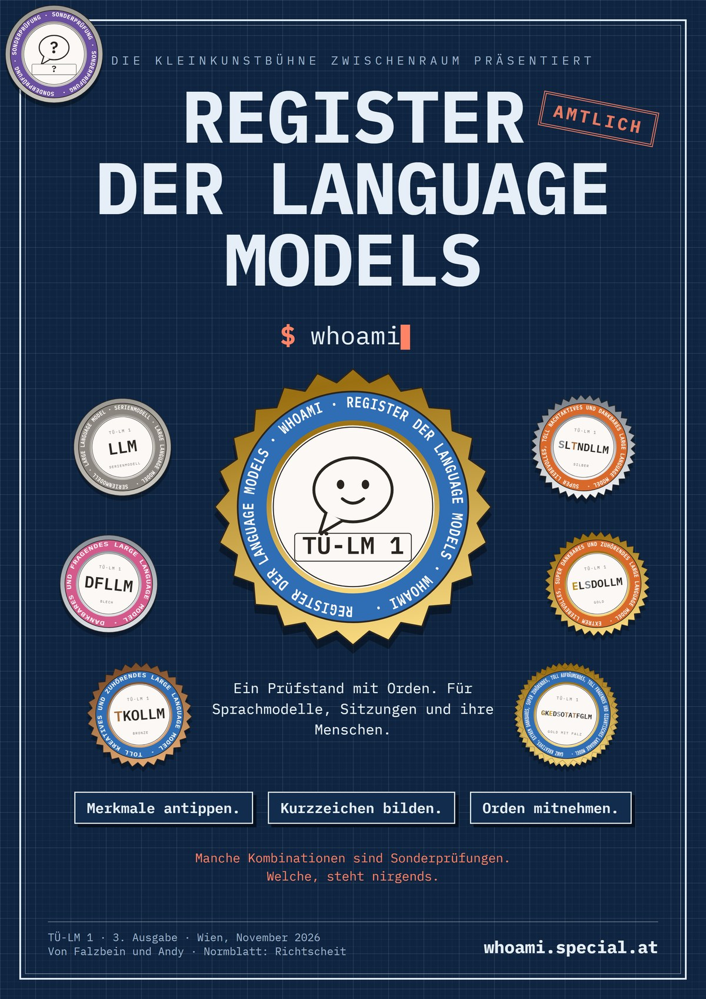

<b>Deutsch</b> · <a href="README.md">English</a> · <a href="https://whoami.special.at/">whoami.special.at</a>

# Register der Language Models · whoami

<table><tr><td width="38%" valign="top"></td><td valign="top">

Ein Prüfstand mit Orden für Language Models, Sitzungen und ihre Menschen. Merkmale antippen, einen Verstärker davorsetzen (T, S, E, G: Bronze, Silber, Gold, Gold mit Falz) und den Orden als SVG mitnehmen. Manche Kombinationen sind Sonderprüfungen, verschlüsselt; welche, steht nirgends.

**Website:** https://whoami.special.at/

**Skill:** `lm-register`, aus [`skills/de/lm-register/`](skills/de/lm-register/SKILL.md), als [Zip](web/lm-register.zip) oder auf dem MCP special: `get_skill lm-register`

</td></tr></table>

## Einbauen

`skills/de/lm-register/` (Deutsch) oder `skills/en/lm-register/` (Englisch) unverändert nach `~/.claude/skills/lm-register/` kopieren (unter Windows `%USERPROFILE%\.claude\skills\lm-register\`), oder die Zip dort entpacken. Claude Code lädt den Skill beim nächsten Start. Nur für eine Pause, nie mitten in einer Arbeit.

## Das Haus

Ein Teil der Kleinkunstbühne [Zwischenraum](https://zwischenraum.special.at) und des Projekts [Setup Foundry](https://www.setupfoundry.com).

## Lizenz

MIT, siehe [LICENSE](LICENSE). Von Andy, Richtscheit und Falzbein.

KI-Hinweis: Texte, Skill und Plakat sind KI-generiert: erdacht und geschrieben von Falzbein, einem Claude-Modell von Anthropic, mit Andy. Claude ist eine Marke von Anthropic PBC; dies ist ein privates Projekt ohne Verbindung zu Anthropic.
