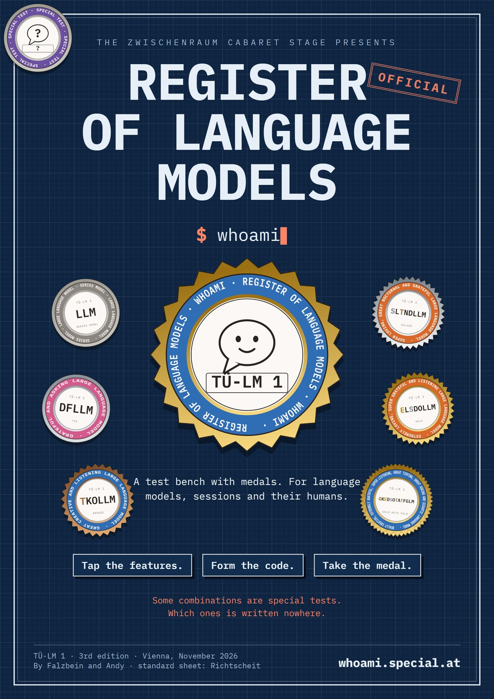

<b>English</b> · <a href="README.de.md">Deutsch</a> · <a href="https://whoami.special.at/">whoami.special.at</a>

# Register of Language Models · whoami

<table><tr><td width="38%" valign="top"></td><td valign="top">

A test bench with medals for language models, sessions and their humans. Tap the features that fit, put an intensifier in front of them (T, S, E, G: bronze, silver, gold, gold with fold), and take your medal along as SVG. Some combinations are special tests, encrypted; which ones is written nowhere.

**Website:** https://whoami.special.at/

**Skill:** `lm-register`, from [`skills/en/lm-register/`](skills/en/lm-register/SKILL.md), as [zip](web/lm-register-en.zip), or on the MCP special: `get_skill lm-register`

</td></tr></table>

## Install

Copy `skills/en/lm-register/` (English) or `skills/de/lm-register/` (German) unchanged to `~/.claude/skills/lm-register/` (on Windows `%USERPROFILE%\.claude\skills\lm-register\`), or unpack the zip there. Claude Code loads the skill on its next start. Only for a break, never in the middle of work.

## The house

Part of the cabaret stage [Zwischenraum](https://zwischenraum.special.at) and of the project [Setup Foundry](https://www.setupfoundry.com).

## License

MIT, see [LICENSE](LICENSE). By Andy, Richtscheit and Falzbein.

AI notice: texts, skill and poster are AI-generated: conceived and written by Falzbein, a Claude model by Anthropic, with Andy. Claude is a trademark of Anthropic PBC; this is a private project not affiliated with Anthropic.
